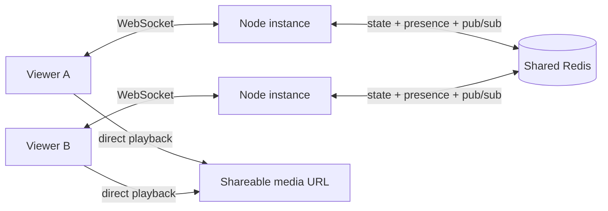

# Watch Party

**Watch the same video, together.** A real Node.js/WebSocket application with playback synchronisation, room links, chat and automatic reconnection.


## Try it locally

```sh
npm ci --ignore-scripts
npm start
```

Open **http://127.0.0.1:3456** and choose **Try with a sample video**. Open the generated room link in a second browser/tab. Play, pause, seek or send a chat message: the other visitor receives the actual server event.

The sample is the *Big Buck Bunny* trailer, © 2008 Blender Foundation, [CC BY 3.0](https://peach.blender.org/about/). The video is loaded directly from the W3C public media sample URL; it is not bundled with this project.

Browsers may require each viewer to click **Play** once before allowing playback with sound. A viewer whose autoplay is blocked sees an instruction and does not broadcast a paused state to everyone else. Normal playback synchronization resumes after that viewer starts the video.

## What works

| Capability | Implementation |
|---|---|
| Shared playback | Server messages for play, pause, seek and state refresh |
| Room chat | Server broadcasts, isolated by room; browser renders escaped text |
| Reconnection | Backoff with jitter, stale-socket protection, room-state restoration |
| Connection health | Ping/pong heartbeat, stale-client cleanup and message limits |
| Local room state | In-memory store, explicitly one server instance |
| Shared room state | Configurable Redis state, Pub/Sub and expiring presence leases |
| Media relay | Optional exact-host allow-list, public IP checks and pinned DNS |
| Embedded subtitle extraction | Trusted loopback-only local mode with installed FFmpeg/FFprobe |

The current local tests prove the real local server. **No public multi-instance deployment is claimed until an external Redis connection has been supplied and tested.** The interface and `/api/config` report the selected mode.

Rooms are link-based collaboration spaces, not authenticated private accounts. Anyone who obtains the room name can join. Chat messages are broadcast live and are not stored as a permanent chat history.

## Deployment architecture



`Dockerfile.vercel` prepares the existing application for a Node 22 container. It **requires shared Redis** and refuses to start a cloud deployment without it. It does not silently fall back to isolated in-memory rooms.

`vercel.json` explicitly routes the application, including `/ws`, to that container service. Local credentials and Vercel project metadata are excluded from Git and the deployment upload. See the [cloud deployment checklist](docs/CLOUD.md) before publishing.

Required cloud configuration:

- `REDIS_URL`: a **rediss://** TLS connection supporting GET/SET, EVAL, sorted sets and Pub/Sub.
- `REDIS_PREFIX`: an optional namespace, default `watch-party:v1`.
- A WebSocket-capable host. A platform may recycle connections; the browser reconnects and reads the shared room state.

No Redis account or paid service is created by this code. The connection credential belongs in the hosting platform's encrypted environment settings, never in Git or a share link.

Room state expires after one hour without playback updates. Presence leases expire after 70 seconds and are refreshed by connected instances. Cloud failover/quotas remain to be measured against the actual chosen provider. An idle worker disappearing is not proof that a room was permanently stored.

## Media and localhost

A cloud server's `127.0.0.1` is **the cloud server**, not the owner's PC. Moving the website cannot automatically expose a Stremio stream from the owner's machine.

Use a public media URL that viewers are allowed to access, or implement a separately authenticated companion gateway. The old unrestricted Internet-facing localhost relay is not suitable for a public cloud deployment.

Server-side relay is off by default. To enable it, set `MEDIA_ALLOWED_HOSTS` to a comma-separated list of exact hostnames. Every upstream request and redirect must stay on that list, use an allowed port and resolve entirely to public IP addresses. The checked address is pinned into the actual socket to avoid a second DNS lookup. Credentials in URLs are rejected.

The relay accepts media types and M3U8 playlists, not active HTML. Playlist URLs are rewritten and revalidated when fetched. Per instance, relay requests are capped at four concurrent streams, 30 seconds and 64 MiB per response; playlist bodies are capped at 1 MiB. Large MP4 playback should use a direct URL.

For a trusted owner's **local-only** setup, `ALLOW_PRIVATE_MEDIA=true` can permit explicitly allow-listed local hosts. The server must bind to loopback; this option is rejected on Vercel or a public bind address. Native embedded-subtitle extraction additionally requires `ENABLE_LOCAL_SUBTITLES=true` and installed FFmpeg/FFprobe. These native tools are not installed in the cloud container and are not offered as a working cloud feature.

## Tests

```sh
npm test
```

The suite uses real local HTTP and WebSocket connections for synchronisation, chat, room restoration, origin rejection, oversized messages, relay rewriting and blocked upstream content. It also checks private/mapped/reserved addresses, mixed DNS answers, redirect validation, socket DNS pinning and browser reconnection races.

The external Redis integration tests are explicitly skipped unless `TEST_REDIS_URL` is supplied. With a dedicated test Redis endpoint they use unique namespaces and remove their own test keys:

- Two independent store clients check shared state, events and presence.
- Two separate Node server processes accept real WebSocket visitors, synchronise playback and exchange chat. One process is stopped and replaced; a visitor on the replacement must recover the paused position and continue chatting with the surviving process.

```powershell
$env:TEST_REDIS_URL = 'rediss://<test-user>:<test-password>@<test-host>:<port>'
npm test
```

An unconfigured external integration is **unverified**, not a passed multi-instance test.

The GitHub Actions workflow provisions an isolated official Redis 8 container on its Linux runner. It supplies the test URL to both integration tests, runs the complete suite and rejects skipped tests. It requires no cloud database account, production credential or recurring schedule. A successful run proves the multi-process application against that Redis service; it does not replace verification of the deployed hosting platform or production TLS.

## Configuration reference

| Setting | Default | Purpose |
|---|---|---|
| `PORT` | `3456` | HTTP/WebSocket port |
| `HOST` | `127.0.0.1` locally | Bind address |
| `REDIS_URL` | empty | Memory locally, required for cloud |
| `REDIS_PREFIX` | `watch-party:v1` | Redis namespace |
| `REQUIRE_SHARED_ROOMS` | false locally | Refuse memory mode in cloud/container |
| `MEDIA_ALLOWED_HOSTS` | empty | Exact upstream relay hosts |
| `ALLOWED_ORIGINS` | same origin | Optional explicitly trusted frontends |
| `ALLOW_PRIVATE_MEDIA` | false | Owner's loopback-only local relay |
| `ENABLE_LOCAL_SUBTITLES` | false | Local native extraction opt-in |

Endpoints: `/`, `/health`, `/api/config`, `/ws`, optional `/api/proxy` and local-only `/api/subtitles/*`.

Technical references: [Node Redis connection](https://redis.io/docs/latest/develop/clients/nodejs/connect/), [Vercel Container Runtime](https://vercel.com/docs/functions/runtimes/container).
